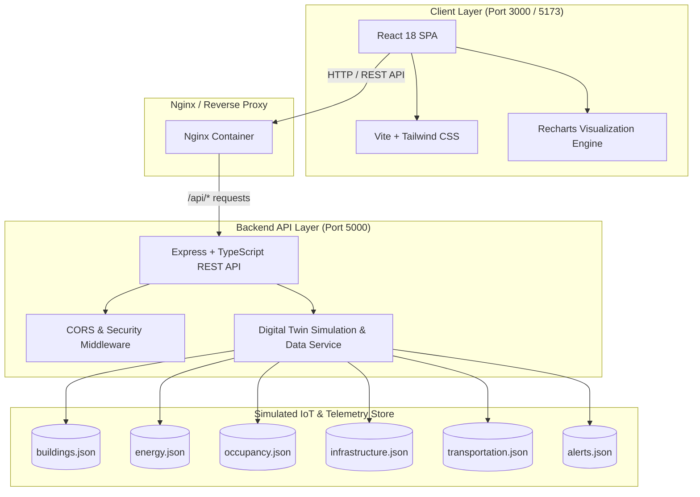

# 🏫 Intelligent Digital Twin for Smart Campus Operations

A comprehensive, production-ready full-stack Digital Twin platform for monitoring campus facilities, real-time building occupancy, electricity and energy consumption, infrastructure health, shuttle fleets, and operational alerts.


---

## 🌟 Executive Summary & Capabilities

The **Smart Campus Digital Twin** provides campus facilities managers, sustainability officers, and operations teams with a centralized, unified operational intelligence cockpit. It aggregates multi-domain data sources:

- **🏛️ Campus Buildings & Facilities**: Live status, occupancy levels, square footage, HVAC/lighting telemetry, and floor-level details for 8 campus buildings.
- **⚡ Energy & Sustainability**: Hourly and daily kWh consumption trends, peak power demand analysis, carbon emissions tracking, solar generation metrics, and building-level energy breakdowns.
- **👥 Occupancy & Utilization**: Room-level utilization rates, capacity warnings, peak hours heatmap data, and dynamic density distribution.
- **🛠️ Infrastructure & Maintenance**: Critical equipment health (HVAC chillers, backup generators, water pumps, elevators, electrical transformers) with predictive maintenance urgency ratings.
- **🚌 Campus Transportation**: Live shuttle tracking across routes (Blue Express, Red Perimeter, Green Connector), current capacity, speed, next stop ETAs, and on-time reliability.
- **🚨 Intelligent Alerts Engine**: Automated alerts prioritized by severity (Critical, Warning, Info) with acknowledge and resolve workflows.

---

## 🏗️ Architecture Diagram



---

## 💻 Tech Stack

### Frontend
- **Framework**: React 18 (TypeScript)
- **Tooling**: Vite 5
- **Styling**: Tailwind CSS 3 with custom campus color palette
- **Icons**: Lucide React
- **Data Visualization**: Recharts (Line charts, Bar charts, Area charts)
- **Testing**: Vitest + React Testing Library + jsdom

### Backend
- **Runtime**: Node.js 20 + TypeScript
- **Web Framework**: Express.js
- **Testing**: Jest + Supertest + ts-jest
- **Data Layer**: Structured simulated IoT telemetry with dynamic stochastic variation

### DevOps & Deployment
- **Containerization**: Docker multi-stage builds (Node alpine + Nginx alpine)
- **Orchestration**: Docker Compose
- **Version Control**: Git branching strategy (`main`, `develop`, `feature/*`)

---

## 📂 Project Structure

```text
smart-campus-digital-twin/
├── .env.example               # Environment variables template
├── .gitignore                 # Standard exclusions
├── docker-compose.yml         # Container orchestration
├── README.md                  # Comprehensive documentation
├── backend/                   # Express TypeScript REST API
│   ├── Dockerfile             # Multi-stage production Dockerfile
│   ├── jest.config.js         # Jest test configuration
│   ├── package.json           # Backend dependencies and scripts
│   ├── tsconfig.json          # TypeScript configuration
│   ├── tests/                 # Supertest endpoint integration tests
│   │   └── api.test.ts
│   └── src/
│       ├── app.ts             # Express application setup & middleware
│       ├── index.ts           # Server entry point
│       ├── types/             # TypeScript interfaces
│       ├── services/          # Data service & telemetry simulator
│       ├── routes/            # Modular API route controllers
│       └── data/              # Simulated campus telemetry data files
└── frontend/                  # React TypeScript Single Page Application
    ├── Dockerfile             # Multi-stage Dockerfile with Nginx
    ├── nginx.conf             # Nginx reverse proxy configuration
    ├── package.json           # Frontend dependencies and scripts
    ├── vite.config.ts         # Vite build and proxy config
    ├── tailwind.config.js     # Tailwind styling tokens
    ├── index.html             # HTML entry point
    └── src/
        ├── main.tsx           # React bootstrap
        ├── App.tsx            # Main shell with sidebar navigation
        ├── components/        # Reusable UI widgets (KPICard, StatusBadge, etc.)
        ├── pages/             # Domain views (Dashboard, Buildings, Energy, etc.)
        ├── services/          # Frontend API fetcher client
        └── __tests__/         # Component and layout unit tests
```

---

## 🚀 Quick Start Guide

### Prerequisites
- [Node.js](https://nodejs.org/) (v18 or v20 LTS recommended)
- [npm](https://www.npmjs.com/) (v9+)
- [Docker](https://www.docker.com/) & Docker Compose (optional, for containerized run)

---

### Option 1: Running Locally (Recommended for Development)

#### 1. Clone the repository
```bash
git clone https://github.com/suvedhang/smart-campus.git
cd smart-campus
```

#### 2. Start the Backend API
```bash
cd backend
npm install
npm run dev
```
*The backend API will start on `http://localhost:5000`.*

#### 3. Start the Frontend Application (in a new terminal)
```bash
cd frontend
npm install
npm run dev
```
*The dashboard will be available at `http://localhost:5173`.*

---

### Option 2: Running with Docker Compose

Run the entire application stack with a single command:

```bash
docker-compose up --build
```

- **Frontend Dashboard**: `http://localhost:3000`
- **Backend API**: `http://localhost:5000/api/health`

To stop the containers:
```bash
docker-compose down
```

---

## 📡 REST API Reference

| Method | Endpoint | Description |
|--------|----------|-------------|
| `GET` | `/api/health` | Service health status and timestamp |
| `GET` | `/api/dashboard` | Aggregated campus KPI summary (occupancy, energy, alerts, transit) |
| `GET` | `/api/buildings` | List of all 8 campus buildings with status & specs |
| `GET` | `/api/buildings/:id` | Detailed building data including room breakdown |
| `GET` | `/api/energy` | Overall energy telemetry, daily consumption & building breakdown |
| `GET` | `/api/occupancy` | Real-time occupancy statistics, peak hours & room metrics |
| `GET` | `/api/infrastructure` | Status of equipment, HVAC, generators, and maintenance |
| `GET` | `/api/transportation` | Shuttle routes, live vehicle positions, speed and occupancy |
| `GET` | `/api/alerts` | Active campus alerts with severity filtering |
| `PATCH` | `/api/alerts/:id` | Update alert status (`acknowledged` or `resolved`) |

### Example API Response (`GET /api/dashboard`)

```json
{
  "totalBuildings": 8,
  "totalOccupancy": 4210,
  "maxCapacity": 6500,
  "occupancyRate": 64.8,
  "currentPowerKW": 845.2,
  "dailyEnergyKWh": 14250,
  "activeAlertsCount": 4,
  "criticalAlertsCount": 1,
  "activeShuttles": 5,
  "shuttleFleetCount": 6,
  "sustainabilityScore": 88
}
```

---

## 🧪 Running Tests

### Backend Tests (Jest)
```bash
cd backend
npm test
```
*Executes 13 automated tests verifying health check, data retrieval, API filters, and alert resolution mutations.*

### Frontend Tests (Vitest)
```bash
cd frontend
npm test
```
*Verifies component rendering, navigation switching, and UI integrity.*

---

## 🌿 Git Branching Strategy

This project adheres to a standard Gitflow-inspired branching convention:

- **`main`**: Production-ready, validated code.
- **`develop`**: Integration branch for completed features.
- **`feature/backend`**: Express API, telemetry models, routes, and Jest test suite.
- **`feature/frontend`**: React dashboard, charts, UI components, and Vitest suite.

---

## 📜 License

This project is licensed under the MIT License.
